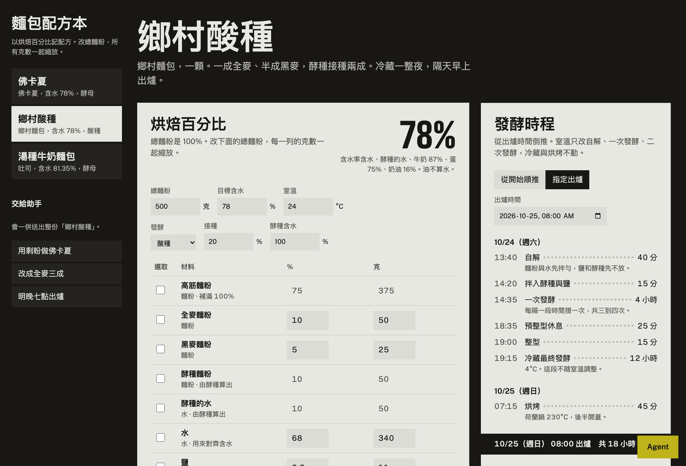
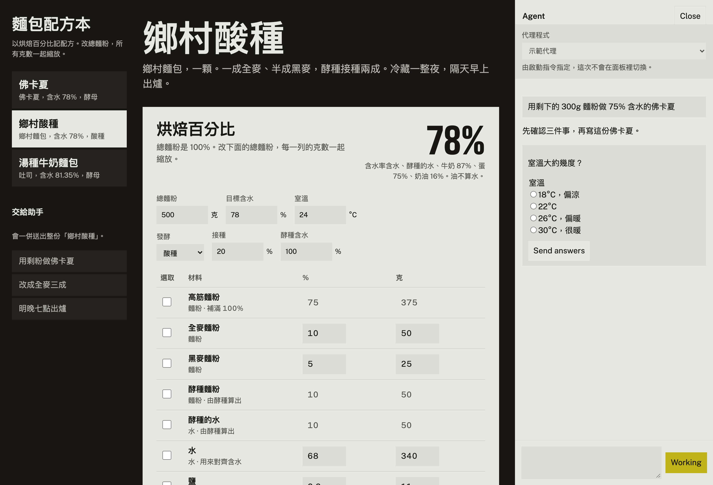
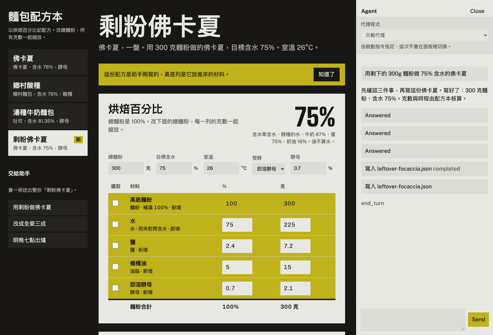
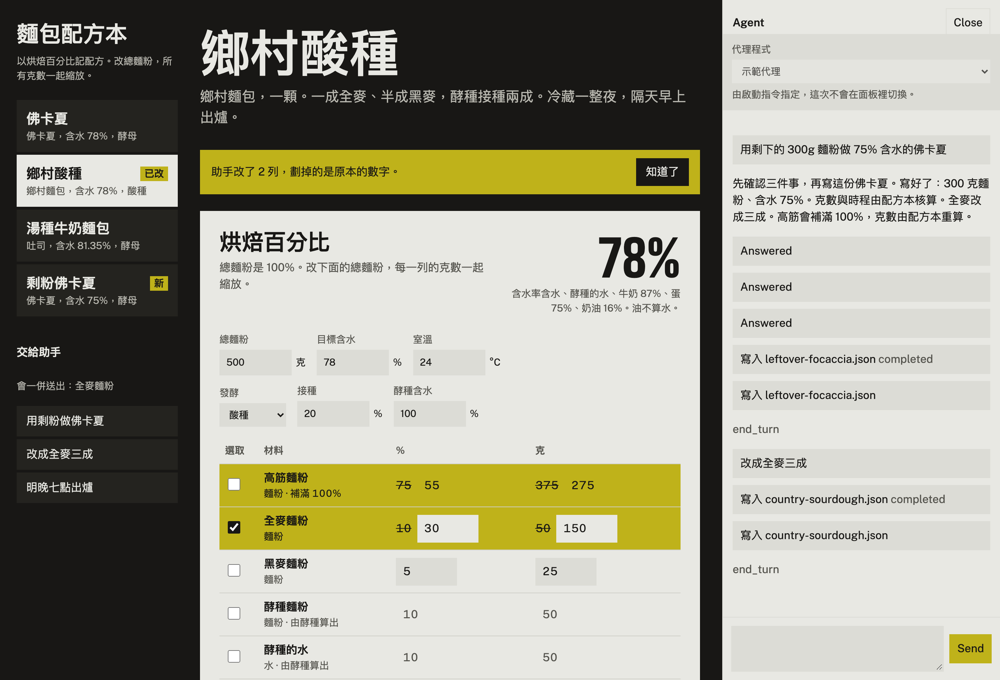

# 麵包配方本

以烘焙百分比記配方的筆記本。改總麵粉，所有材料的克數一起縮放；含水率、酵種與發酵時程由程式計算。旁邊可以打開 [agent-panel](https://github.com/Jacky97s/agent-panel)，把選取的配方交給你自己的 Claude Code 或 Codex，不另收 API 費用。



## 這本筆記做什麼

- 配方是 `data/recipes/*.json`。內建佛卡夏、鄉村酸種、湯種牛奶麵包。
- 百分比以總麵粉為 100%，酵種裡的麵粉也算在內。
- 改總麵粉，克數等比縮放。含水率含水、酵種的水、牛奶（87%）、蛋（75%）與奶油（16%）。油不算水。
- 發酵時程可以從開始時間順推，或從出爐時間倒推。室溫只調整自解、一次發酵與二次發酵；冷藏與烘烤不動。
- 助手只寫 `data/recipes/*.json`。克數、含水率與步驟分鐘數寫了也會被程式蓋掉，所以數字始終對得起來。

可以這樣交代助手：

- 「用剩下的 300g 麵粉做 75% 含水的佛卡夏」。它會先用提問卡問室溫、酸種或即溶酵母、想什麼時候出爐，再寫配方與時程。
- 選一份配方或幾列材料，說「改成全麥三成」。高筋會補滿 100%，改過的列會標成黃底，劃掉的是原本的數字。
- 「明天晚上 7 點要出爐，幫我排時間」。時程從出爐時間倒推，時區是台北。







## 怎麼用 agent-panel

框架放在 `vendor/agent-panel`，釘在 `c47a6717a68e731e0ac5db653679650249aad6d7`（[agent-panel#1](https://github.com/Jacky97s/agent-panel/pull/1) 的提交）。沒有把它的原始碼抄進這個專案。

capability `bread-book` 註冊在 Vite plugin 上：

- 可寫目錄只有 `data/recipes`。
- 允許的工具只有 `write`。讀寫超出這個目錄會被拒絕。
- `buildContext` 把目前配方、選取的材料列與資料夾路徑放進提示。
- 面板預設收合，由你自己打開。
- 助手寫完檔案後，畫面會重新讀取。讀取時先跑 `normalizeRecipe`，克數與含水率在送到畫面之前就對齊。

百分比、克數分配、含水率、室溫係數與倒推時程都在 `src/lib/`，有單元測試。助手如果寫了 `wholeWheatPercent`、`scheduleRequest` 或手填的克數，也是走同一支函式。

用 Claude Code 或 Codex 時，面板裡會顯示：本次使用你自己的訂閱，額外 API 費用 $0。

## 執行

需要 Node.js 20.19 以上與 pnpm 10。

```bash
pnpm install
pnpm dev
```

打開 http://127.0.0.1:5173 。預設是示範代理，不需要安裝 Claude、Codex 或 Gemini。它會問問題、請求寫入許可，然後寫 JSON。

換成你自己的代理：

```bash
BREAD_AGENT=claude-code pnpm dev
BREAD_AGENT=codex pnpm dev
BREAD_AGENT=gemini pnpm dev
```

對應的指令是 `@agentclientprotocol/claude-agent-acp`、`@agentclientprotocol/codex-acp`，以及 `gemini --experimental-acp`。登入與模型選擇留在各 CLI。面板上方的選單也可以切換；切換會重新啟動開發伺服器。若啟動時已用 `BREAD_AGENT` 指定，選單會鎖住。

```bash
pnpm test
```

單元測試涵蓋縮放、含水率、湯種倍數、全麥補滿、室溫與倒推時程。Playwright 用示範代理走一次縮放、三張提問卡，以及全麥差異標示。

## 框架目前補不上的地方

這些是 agent-panel 0.1 的限制，示範裡用應用程式自己的程式繞過，沒有改框架：

- 面板沒有代理程式選單，也沒有可插入的橫幅。選單與「使用你自己的訂閱」放在面板頂部，切換時代理行程要靠重啟 Vite。`/__agent/status` 對 Claude Code 與 Codex 都只回 `npx`，所以這本筆記自己記現在用哪一個。
- 從瀏覽器送出的 context 只保留字串、數字與布林，巢狀物件會被丟掉，字串截到 4000 字。選取的材料因此編成字串。
- `onComplete` 在 `result` 事件之後才跑。若只等那個事件就去讀檔，可能讀到助手剛寫下、尚未核算的 JSON。讀取 API 會先核算再回傳。
- 檔案讀寫的範圍就是可寫目錄，助手讀不到目錄以外的說明。欄位說明放在 `data/recipes/SCHEMA.md`，並寫進系統提示。工具白名單只認工具名稱，不認副檔名。
- 面板按鈕（Agent、Send、Close、Send answers）與狀態字（Answered、Working、completed、end_turn）是英文，沒有語系參數。
- 主題 token 只有 `.ap-root` 一組，深色模式寫在框架自己的 media query 裡。應用程式一覆寫 token，就會連深色模式一起蓋掉，所以這本筆記只做一套配色。
- 面板沒有可插入的頂部區塊。代理程式選單用 `position: fixed` 疊在面板標題下方，靠寫死的 49px 對齊，並把對話區往下推。
- 重新連上 WebSocket 時，還沒結束的回合會重播。提問卡與許可卡的「已回答」只記在瀏覽器，重播後會看起來又可以按。
- 真實的 Claude Code / Codex adapter 是否把 ACP 表單提問暴露給模型，取決於 adapter。示範代理一定會發提問卡。
